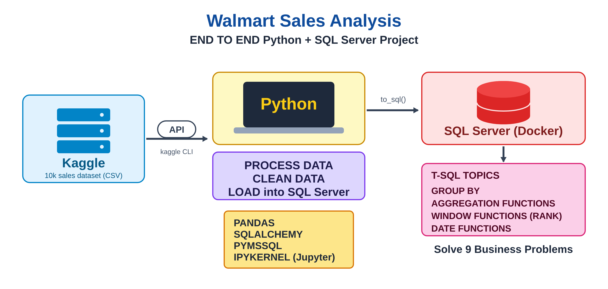

# Walmart Sales Analysis: Python + SQL Server

End-to-end data project: download a Walmart sales dataset from Kaggle, clean it with **pandas**, load it into **SQL Server** (Docker) and answer 9 business questions with **T-SQL**.



## Project structure

```
sql_project_03/
├── project_python.ipynb     # Python steps: load, explore, clean, export to SQL Server
├── project.sql              # Terminal commands (as comments) + all T-SQL queries
├── Walmart.csv              # Raw data (10,051 rows)
├── walmart_clean_data.csv   # Cleaned data (9,969 rows)
├── walmart_project_pipeline.png   # Pipeline diagram (README)
├── requirements.txt         # Python libraries
└── .gitignore
```

## Tools

Python 3.12, pandas, SQLAlchemy, pymssql, Kaggle API, SQL Server 2025 (Docker), VS Code (Jupyter + mssql extension).

## Workflow

1. **Setup**: virtual environment, libraries, Kaggle API token (see `project.sql`, part 1).
2. **Download**: `kaggle datasets download -d najir0123/walmart-10k-sales-datasets`.
3. **Explore** with pandas: 51 duplicated rows, 31 rows with missing values, `unit_price` stored as text (`$74.69`).
4. **Clean**: remove duplicates and missing values, convert `unit_price` to a number, create `total = unit_price x quantity`, lower-case column names. Result: 9,969 rows, 12 columns.
5. **Load** into SQL Server table `walmart` with `df.to_sql()` through SQLAlchemy.
6. **Analyse** with T-SQL (9 business problems, `project.sql`, part 6).

## Business problems solved

1. Number of transactions and quantity sold per payment method
2. Best-rated category in each branch
3. Busiest day of the week for each branch
4. Total quantity of items sold per payment method
5. Minimum, maximum and average rating for each city and category
6. Total revenue and profit for each category
7. Most used payment method in each branch
8. Number of invoices per shift (morning, afternoon, evening)
9. Top 5 branches with the biggest revenue decrease between 2022 and 2023

Example result (problem 9, revenue decrease 2022 to 2023):

| Branch  | Decrease |
|---------|----------|
| WALM045 | 62.62 %  |
| WALM047 | 58.58 %  |
| WALM098 | 57.89 %  |
| WALM033 | 55.65 %  |
| WALM081 | 50.67 %  |

## T-SQL notes

The original tutorial uses PostgreSQL / MySQL. Main adaptations for SQL Server:

- `LIMIT 5` becomes `SELECT TOP 5`
- `TO_DATE(...)` becomes `CONVERT(date, [date], 3)` (dd/mm/yy format)
- `TO_CHAR(date, 'Day')` becomes `DATENAME(WEEKDAY, ...)`
- `EXTRACT(HOUR ...)` becomes `DATEPART(HOUR, ...)`
- `GROUP BY 1, 2` is not allowed: columns are written in full
- `rank` is a reserved word: the alias `rnk` is used

## How to run

1. Start SQL Server in Docker (port 1433) and create the database (`walmart_db`, see `project.sql`, part 5).
2. Create the environment and install the libraries:
   ```bash
   python3 -m venv my_env1
   source my_env1/bin/activate
   pip install -r requirements.txt
   ```
3. Run `project_python.ipynb` cell by cell (the SQL password is typed in a pop-up, never stored).
4. Run the queries of `project.sql` in VS Code (mssql extension).

## Security

Never commit your Kaggle token or your SQL Server password. The files in this repository contain neither.
