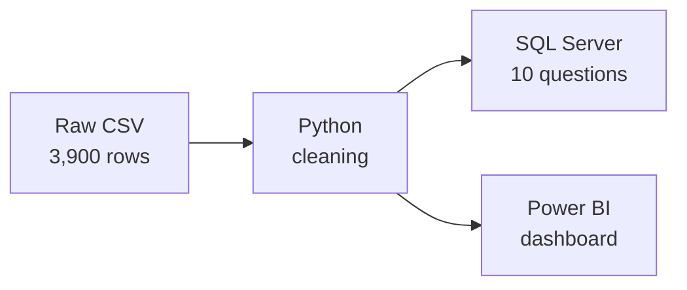

# Customer Shopping Behavior Analysis

End-to-end data analytics project on retail customer data: data cleaning in **Python**, business analysis in **SQL Server**, and an interactive dashboard in **Power BI**.

## Overview

A retail company wants to understand how its customers shop in order to improve sales, customer satisfaction and loyalty.

**Business question:** how can the company use customer shopping data to identify trends, improve customer engagement and optimize its marketing and product strategies?



## Dataset

`customer_shopping_behavior.csv`: 3,900 rows (one customer and their latest purchase) and 18 columns.

| Group | Columns |
|---|---|
| Customer | customer ID, age, gender, location, subscription status |
| Purchase | item, category, amount (USD), size, color, season |
| Behavior | review rating, shipping type, discount, promo code, previous purchases, payment method, purchase frequency |

## Tools

- **Python 3.12** (pandas, SQLAlchemy, pymssql) in a Jupyter notebook
- **SQL Server** running in Docker
- **Power BI Desktop**
- VS Code on macOS (Apple Silicon)

## Project Steps

**1. Data cleaning and preparation (Python)**: `Customer_Shopping_Behavior_Analysis.ipynb`
- Explored the structure and summary statistics of the data
- Filled 37 missing review ratings with the **median rating of the same category**, which respects differences between categories
- Renamed all columns to snake_case
- Created `age_group` (4 equal-sized groups) and `purchase_frequency_days` (text frequency converted to days)
- Dropped `promo_code_used`, which was identical to `discount_applied`
- Loaded the clean table into SQL Server (the password is typed at runtime with `getpass` and never stored)

**2. Business analysis (SQL Server)**: `customer_behavior_sql_queries.sql`

10 business questions answered with aggregations, subqueries, CASE, CTEs and window functions (`ROW_NUMBER`).

**3. Dashboard (Power BI)**: in progress

## Key Results

| Question | Result |
|---|---|
| Revenue by gender | Male $157,890 vs. Female $75,191 |
| Discount users spending above average ($59.76) | 839 customers |
| Top rated products | Gloves (3.86), Sandals (3.84), Boots (3.82), Hat (3.80), Skirt (3.78) |
| Express vs. Standard shipping | $60.48 vs. $58.46 average purchase |
| Subscribers vs. non-subscribers | 1,053 subscribers ($59.49 avg, $62,645) vs. 2,847 non-subscribers ($59.87 avg, $170,436) |
| Most discount-dependent products | Hat (50%), Sneakers (49.7%), Coat (49.1%), Sweater (48.2%), Pants (47.4%) |
| Customer segments | Loyal 3,116 · Returning 701 · New 83 |
| Top product per category | Jewelry, Blouse / Pants, Sandals, Jacket |
| Repeat buyers (>5 purchases) who subscribe | 958 of 3,476 (28%) |
| Revenue by age group | Young Adult $62,143 > Middle-aged $59,197 > Adult $55,978 > Senior $55,763 |

## Business Recommendations

- **Grow subscriptions**: most loyal customers are not subscribed (72% of repeat buyers). Exclusive benefits could convert them.
- **Reward loyalty**: Loyal customers are the large majority. A loyalty program can keep them and move "Returning" customers up.
- **Review discount policy**: about half of Hat, Sneakers and Coat sales use a discount. Test smaller discounts to protect margins.
- **Promote best-rated products**: highlight Gloves, Sandals and Boots in campaigns.
- **Target the right segments**: Young Adults bring the most revenue, and Express shipping customers spend slightly more.

## Repository Structure

```
├── customer_shopping_behavior.csv            # raw dataset
├── customer_behavior_cleaned.csv             # cleaned dataset (Power BI source)
├── Customer_Shopping_Behavior_Analysis.ipynb # Python cleaning + load to SQL Server
├── customer_behavior_sql_queries.sql         # SQL business questions
└── README.md
```

## How to Run

1. Clone the repository and create a virtual environment:
   ```bash
   python3 -m venv .venv
   source .venv/bin/activate
   pip install pandas sqlalchemy pymssql ipykernel
   ```
2. Start SQL Server (e.g. in Docker) and run the first part of `customer_behavior_sql_queries.sql` to create the `customer_behavior` database.
3. Run the notebook. It cleans the data and loads the `customer` table into SQL Server (you will be asked for the password).
4. Run the business questions in `customer_behavior_sql_queries.sql`.

## Acknowledgements

Project based on the tutorial by [Amlan Mohanty](https://github.com/amlanmohanty1/customer-trends-data-analysis-SQL-Python-PowerBI), adapted to SQL Server, macOS and pymssql.
