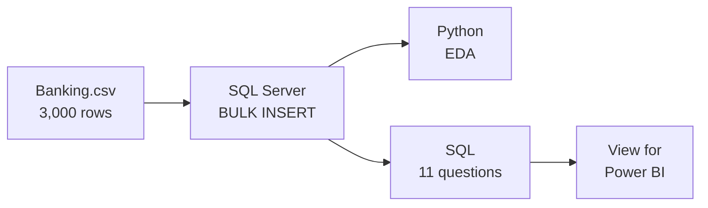

# Banking Risk Analysis

End-to-end data analytics project on banking client data: data loading and business analysis in **SQL Server**, exploratory data analysis in **Python**, and a dashboard in **Power BI** (in progress).

## Overview

Banks lend money to clients with very different profiles, and some of them never pay it back. The goal is to understand who the clients are, where the loans and deposits sit, and how data can help reduce the risk of losing money when lending.

**Business question:** how are loans and deposits distributed across client profiles (income, gender, nationality, banking relationship, risk level), and where is the lending risk concentrated?



## Dataset

`Banking.csv`: 3,000 rows (one per client) and 25 columns, no missing values.

| Group | Columns |
|---|---|
| Client | client ID, name, age, location, joining date, banking contact, nationality, occupation, fee structure, loyalty classification |
| Finances | estimated income, superannuation savings, credit cards (count and balance), bank loans, bank deposits, checking, savings, foreign currency account, business lending |
| Codes | properties owned, risk weighting, banking relationship (BRId), gender (GenderId), investment advisor (IAId) |

Code meanings: `GenderId` 1 = Male, 2 = Female · `BRId` 1 = Retail, 2 = Institutional, 3 = Private Bank, 4 = Commercial.

## Tools

- **SQL Server** running in Docker
- **Python 3** (pandas, matplotlib, seaborn, SQLAlchemy, pymssql) in a Jupyter notebook
- **Power BI** (final step, in progress)
- VS Code with the SQL Server (mssql) extension on macOS (Apple Silicon)

## Project Steps

**1. Database and data loading (SQL Server)**: `banking_project.sql`, parts 1 to 3
- Created the `banking_project` database and the `customer` table with typed columns (`DECIMAL` for amounts, `DATE` for the joining date)
- Copied the CSV into the Docker container and loaded it with `BULK INSERT`, reading dates as day-month-year

**2. Exploratory data analysis (Python)**: `banking_eda.ipynb`
- Loaded the table from SQL Server (the password is typed at runtime with `getpass` and never stored)
- Checked structure, missing values and summary statistics; converted the joining date to a real date
- Created `Income_Band` (Low < 100k, Mid 100k–300k, High ≥ 300k)
- Univariate and bivariate analysis of categorical columns, distributions of numerical columns, correlation matrix and scatter plots

**3. Business analysis (SQL Server)**: `banking_project.sql`, Q1 to Q11
- 11 business questions answered with aggregations, `CASE`, `TOP`, window functions (`SUM() OVER ()`)
- A view (`vw_customer_dashboard`) with labels and totals ready for Power BI
- A stored procedure (`sp_kpi_by_nationality`) returning the key figures of any nationality

**4. Dashboard (Power BI)**: in progress, will connect to `vw_customer_dashboard`.

## Key Results

Total loan = bank loans + business lending + credit card balance · Total deposit = bank deposits + savings + checking + foreign currency.

| Question | Result |
|---|---|
| Key figures | 3,000 clients · total loan 4.38 B · total deposit 3.77 B · business lending 2.60 B |
| Loans by gender | Male 1,488 clients (2.19 B) vs. Female 1,512 clients (2.19 B): no real difference |
| Best joining years | 2020 (248 new clients), 2021 (194), 2019 (187) |
| Bank loans by income band | Mid 53.1% · Low 25.3% · High 21.6% |
| Bank loans by relationship | Private Bank 0.81 B (1,352 clients) > Retail 0.38 B > Commercial 0.30 B > Institutional 0.28 B |
| Top nationalities (bank loans) | European 0.78 B, Asian 0.44 B, American 0.31 B |
| Deposits by nationality | European 1.64 B, Asian 0.96 B, American 0.63 B |
| Loan-to-deposit ratio by risk level | between 1.10 and 1.18 for every risk level |
| Strongest correlations (EDA) | Bank deposits with checking (0.84) and savings (0.75); bank loans with business lending (0.42) |

## Business Recommendations

- **Watch the overall balance**: the bank lends more than it holds in deposits (ratio above 1 at every risk level). Risk is spread across all clients, not only the "risky" ones.
- **Review the risk weighting**: high-risk clients do not borrow more than low-risk ones relative to their deposits, so the current score does not seem to limit lending.
- **Focus on Private Bank and Mid-income clients**: they hold the largest share of loans, so they matter most for risk monitoring.
- **Monitor multi-product borrowers**: clients with large bank loans also tend to use business lending, which concentrates exposure.
- **Use deposits as a signal**: deposits, savings and checking move together, so a drop in one account is an early warning for the others.

## Repository Structure

```
├── Banking.csv            # raw dataset
├── banking_project.sql    # database, table, BULK INSERT, business questions, view, procedure
├── banking_eda.ipynb      # Python EDA (data loaded from SQL Server)
├── requirements.txt       # Python packages
└── README.md
```

## How to Run

1. Clone the repository and create a virtual environment:
   ```bash
   python3 -m venv .venv
   source .venv/bin/activate
   pip install -r requirements.txt
   ```
2. Start SQL Server in Docker and copy the CSV into the container:
   ```bash
   docker cp ./Banking.csv sql_server_container:/tmp/Banking.csv
   ```
3. Run parts 1 to 3 of `banking_project.sql` to create the database and load the `customer` table (3,000 rows).
4. Run the notebook `banking_eda.ipynb` (you will be asked for the SQL Server password).
5. Run the business questions Q1 to Q11 in `banking_project.sql`.

## Adaptations from the Original Tutorial

The original tutorial uses MySQL, `mysql.connector` and Google Colab. Main changes:

- **SQL Server instead of MySQL**: `BULK INSERT` instead of the MySQL import wizard, `TOP` instead of `LIMIT`, `CREATE OR ALTER` instead of `CREATE OR REPLACE`, `sys.databases` instead of `SHOW DATABASES`.
- **Secure connection**: the tutorial writes the password in the code (`password="root"`). Here it is typed at runtime with `getpass`, encoded with `quote_plus`, and the data is read with SQLAlchemy + pymssql.
- **More SQL**: the tutorial uses SQL only to store the data. Here the dashboard figures are also computed with SQL business questions, a view and a stored procedure.

## Acknowledgements

Project based on the Banking EDA tutorial by Satyajit Pattnaik, adapted to SQL Server, macOS and pymssql.
